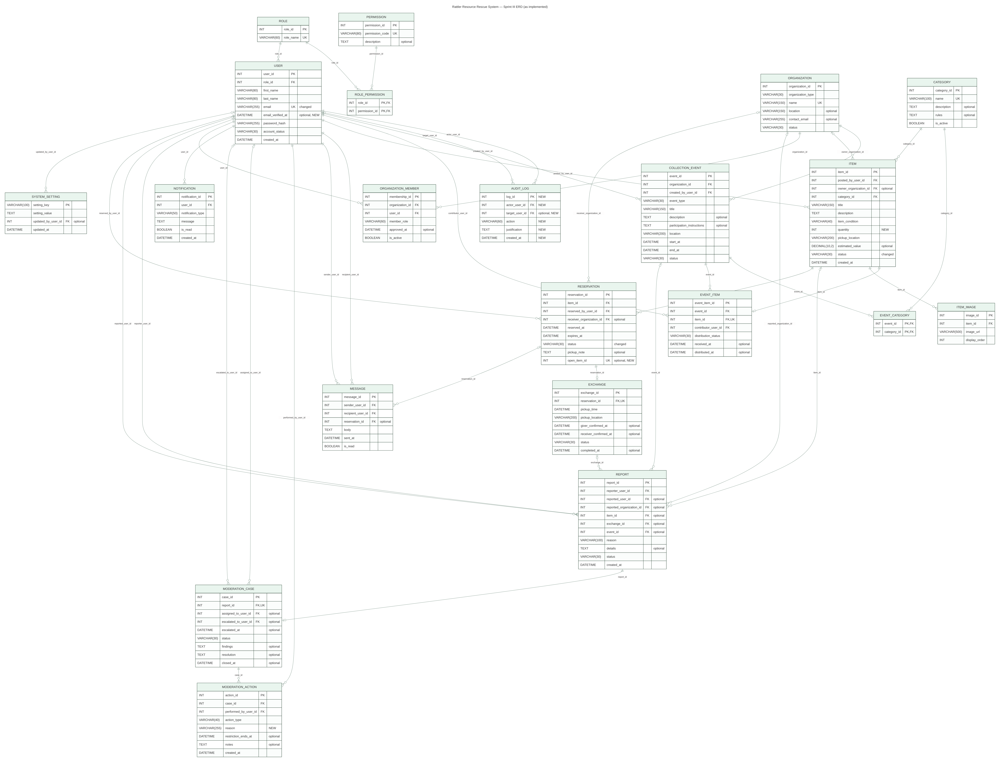

# Sprint III ERD (as implemented)

Generated from the implemented MySQL database by `../Database/tools/generate_docs.py`, so the diagram matches `01_schema.sql` exactly.

| File | Contents |
|---|---|
| [Sprint-III-ERD.pdf](Sprint-III-ERD.pdf) | **Full ERD, best for viewing** (vector, zoom freely) |
| [Sprint-III-ERD.png](Sprint-III-ERD.png) | Full ERD as an image |
| ERD-1 … ERD-4 (`.png`, `.pdf`) | The ERD split into four readable areas: users/roles/organizations/audit, items/reservations/exchanges/messages, collection drives, reports/moderation |
| `*.mmd` | Mermaid source (renders on GitHub; edit and re-export to change the diagram) |

**Notation (crow’s foot):** `||` exactly one · `|o` zero or one · `o{` zero or many · `o|` zero or one on the child side (a unique foreign key, i.e. one-to-one). Each line is labeled with the foreign-key column. Attributes show type, name, key (PK, FK, UK), and `optional` (nullable), `NEW` (added in Sprint III) or `changed` (modified in Sprint III).

